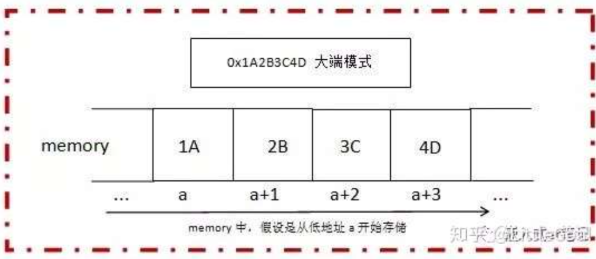
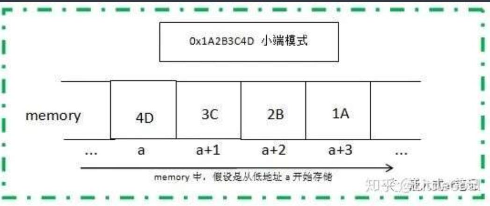

# [嵌入式er笔记]大端小端详解(含代码及详细注释) - 知乎

首发于

[嵌入式er笔记](https://www.zhihu.com/column/c_1250096106878685184)

**之前文章《 [浅谈ARM ABI，Android ABI](https://link.zhihu.com/?target=http%3A//mp.weixin.qq.com/s%3F__biz%3DMzAxODkwMzM4Mw%3D%3D%26mid%3D2247483758%26idx%3D1%26sn%3D7c182271447da0d2fa517b329c1e4c68%26chksm%3D9bce7956acb9f040a0f8235a7075fcb6f5ad74673ed2caa30d437d4adc837b2d758787e91b6c%26scene%3D21%23wechat_redirect) 》中有提到计划专门一篇文章讲下大小端，今天兑现一下。**

**1>"大端" "小端"的来源**

关于大端小端名词的由来，网传有一个有趣的故事，可以追溯到1726年的Jonathan Swift的《格列佛游记》，其中一篇讲到有两个国家因为吃鸡蛋究竟是先打破较大的一端还是先打破较小的一端而争执不休，甚至爆发了战争。

《格利佛游记》：“Lilliput和Blefuscu这两个强国在过去的36个月中一直在苦战。战争的原因是：我们都知道，吃鸡蛋的时候，原始的方法是打破鸡蛋较大的一端，可是那时的皇帝的祖父由于小时侯吃鸡蛋，按这种方法把手指弄破了，因此他的父亲，就下令，命令所有的子民吃鸡蛋的时候，必须先打破鸡蛋较小的一端，违令者重罚。然后老百姓对此法令极为反感，由此发生了多次叛乱，产生叛乱的原因就是另一个国家Blefuscu的国王大臣煽动起来的。叛乱平息后，流亡的人就逃到这个帝国避难。据估计，先后几次有11000余人情愿si也不肯去打破鸡蛋较小的端吃鸡蛋。”

Swift的《格列佛游记》其实是在讽刺当时英国(Lilliput)和法国(Blefuscu)之间持续的冲突。

现在以大端、小端的命名Big-Endian、Little-Endian看，确实也符合鸡蛋的特征，一切源于生活。

**2> 计算机中“大端”“小端”是指什么**

大端小端真正引入计算机领域，是来自于一位网络协议的早期开创者Danny Cohen，他第一次使用这两个术语指代字节顺序，后来慢慢被大家广泛接受。

字节顺序说的到底是什么，先复习一个基础知识：

**位(bit)**：计算机中的最小数据单位，计算机存储的都是二进制0和1这两个鬼。

**字节(Byte)**：字节是存储空间的基本计量单位，也是内存的基本单位，也是编址单位。例如，一个计算机的内存是4GB，就是该计算机的内存中共有4×1024×1024×1024个字节，意味着它有4G的内存寻址空间。

换算关系：

1 GB = 1024 MB

1 MB = 1024 KB

1 KB = 1024 Bytes

1 Byte = 8 bits

**【Q】：**思考一个问题，通常描述32位二进制数据，为什么是用8个十六进制数呢？如**0x1A2B3C4D**

**【A】：**十六进制(hex)是一种逢16进1的进位制。十六进制的数码有1，2，3，4，5，6，7，8，9，A(10),B(11),C(12),D(13),E(14),F(15)。

**第一种理解：**

4个二进制bit 表示的数值范围是从0000~1111，即0~15, 刚好等同于 一位 16进制数的数值范围0~F(15)。

所以可以类推得出：

1Byte = 8bit；即1个字节包含8个二进制bit，8个二进制bit对应需要2位十六进制数来表示(最大值为 0xFF)；

4Byte = 32bit; 即4个字节包含32个二进制bit，32个二进制bit对应需要8位十六进制数来表示；(最大值为 0xFFFFFFFF)；

**第二种理解：**

因为16=2^4(2的4次方)，所以1位十六进制数可以转化为4位二进制数，即十六进制的每个字符需要用4位二进制位来表示，如0x0为0000，0xF为1111，即1个16进制数为4位二进制bit。

所以反推32位二进制数换算为十六进制数后的位数就变为32÷4=8位，即32位二进制地址信息需要8位十六进制数表示。

**总结下：**

4个二进制位(bit)(不够表示一个字节) = 1个十六进制(hex)。

8个二进制位(bit) = 一个字节(Byte) = 2个十六进制(hex)。

32个二进制位(bit) = 四个字节(Byte) = 8个十六进制(hex)。

所以针对一个32位的数值，如**0x1A2B3C4D**，总共四个字节，两个十六进制数表示一个字节，高位字节为**0x1A**，低位字节为**0x4D**；中间两个字节分别为**0x2B**和**0x3C**；

数值**0x1A2B3C4D**想要在计算机中正确使用，就必须要考虑在内存中将其对应的四个字节合理存储。假设内存的地址都是从低到高分配的，那么对于一个数值多个字节顺序存储就有两种存储方式：

**方式一**、数值的高位字节存放在内存的低地址端，低位字节存放在内存的高地址端：

内存低地址 --------------------> 内存高地址

0x1A | 0x2B | 0x3C | 0x4D

高位字节 <-------------------- 低位字节

**方式二**、数值的低位字节存放在内存的低地址端，高位字节存放在内存的高地址端：

内存低地址 --------------------> 内存高地址

0x4D | 0x3C | 0x2B | 0x1A

低位字节 --------------------> 高位字节

**方式一 ，**我们就称之为 大端模式；即高位字节放在内存的低地址端，低位字节放在内存的高地址端。

**方式二 ，**我们就称之为 小端模式；即低位字节放在内存的低地址端，高位字节放在内存的高地址端。

**画图更直观理解一下：**





**总结下：**

- 大端小端是不同的字节顺序存储方式，统称为**字节序**；
- **大端模式**，是指数据的高字节位 保存在 内存的低地址中，而数据的低字节位 保存在 内存的高地址中。这样的存储模式有点儿类似于把数据当作字符串顺序处理：地址由小向大增加，而数据从高位往低位放。和我们”从左到右“阅读习惯一致。
- **小端模式**，是指数据的高字节位 保存在 内存的高地址中，而数据的低字节位 保存在 内存的低地址中。这种存储模式将地址的高低和数据位权有效地结合起来，高地址部分权值高，低地址部分权值低，和我们的逻辑方法一致。

**分享一个私人口语化记忆小技巧：**

- **大端模式**：“【低位】字节却硬要存在【高】地址中“。---“低对高(或高对低)，门不当户不对，真令人头大”，记作大端模式。
- **小端模式**：“【低位】字节正好存在【低】地址中”。--- “低对低，门当户对，你侬我侬”，记作小端模式。

**3> 为什么要学习理解“大端”“小端”**

**大端模式：**

基于其存储特点，符号位在所表示的数据的内存的第一个字节中，便于快速判断数据的正负和大小（CPU做数值运算时从内存中依顺序依次从低位地址到高位地址取数据进行运算，大端就会最先拿到数据的(高字节的)符号位）。

**小端模式：**

基于其存储特点，内存的低地址处存放低字节，所以在强制转换数据时不需要调整字节的内容（比如，把int---4字节强制转换成short---2字节，就可以直接把int数据存储的前两个字节给short就行，因为其前两个字节刚好就是最低的两个字节，符合转换逻辑；另外CPU做数值运算时从内存中依顺序依次从低位地址到高位地址取数据进行运算，开始只管取值，最后刷新最高位地址的符号位就行，这样的运算方式会更高效一些）。

因为两种模式各有优点，存在“你有我无，你无我有”的特点，所以造就了不同的硬件厂商基于不同的效率(角度)考虑，有了不同的硬件设计支持，最终形成了计算机各个相关领域目前并没有采用统一的字节序，没有统一标准的现状。

其实也不难理解，就好比文章开头描述的“吃鸡蛋方式之争一样” 天下之大又有谁能站出来限定或证明，吃鸡蛋必须从“小端”开始，就一定比从“大端”开始 好？或者 吃鸡蛋必须从“大端”开始，就一定比从“小端”开始 好？呢。

**“大端“ ”小端” 各有优点，同吃鸡蛋方式一样，世人都有各自选择的权利。**

**目前我们常见的CPU PowerPC、IBM是大端模式，x86是小端模式。ARM既可以工作在大端模式，也可以工作在小端模式，一般ARM都默认是小端模式。一般通讯协议都采用的是大端模式。**

另外，常见文件的字节序如下：

BMP – Little Endian

GIF – Little Endian

JPEG – Big Endian

RTF – Little Endian

Adobe PS – Big Endian

DXF(AutoCAD) – Variable

所以我们只有理解“大端”“小端”，才能在跨平台、跨芯片、跨系统，跨网络通信时，实时对内存字节序进行检查和转换，保证传递内容的正确性。假设没有操作系统工程师，网络工程师在背后默默对字节序的检查和转换，可能你用你的X86机器通过QQ给我PowerPC机器QQ表了个白，但数据在内存中传递乱的yipi，消息到了以后，前言不搭后语，我都完全不知道你想说什么，也不知道你在表白，彼此完美错过将是结局。

**4> 通过C代码检测当前计算机环境采用的是大端模式还是小端模式。**

**举例：**

- **方式一**： 借助联合体union的特性实现(联合体类型数据所占的内存空间等于其最大的成员所占的空间，对联合体内部所有成员的存取都是相对于该联合体基地址的偏移量为 0 处开始，也就都是从该联合体所占内存的首地址位置开始。）

```c
#include <stdio.h>
int main()
{
    union{
      int a;  //4 bytes
      char b; //1 byte
    } data;

    data.a = 1; //占4 bytes，十六进制可表示为 0x 00 00 00 01

    //b因为是char型只占1Byte，a因为是int型占4Byte
    //所以，在联合体data所占内存中，b所占内存等于a所占内存的低地址部分
    if(1 == data.b){ //走该case说明a的低字节，被取给到了b，即a的低字节存在了联合体所占内存的(起始)低地址，符合小端模式特征
      printf("Little_Endian\n");
     } else {
      printf("Big_Endian\n");
     }
   return 0;
}
```

**说明：**

赋值 1 是数据的低字节位(0x00000001)。

如果 1 被存储在 data所占内存 的低地址中，那data.b 的值将会是 1，就是小端模式。

如果 1 被存储在 data所占内存 的高地址中，那data.b 的值将会是 0，就是大端模式。

- **方式二**： ： 通过将int强制类型转换成char单字节，判断起始存储位置内容实现。

```c
#include <stdio.h>
int main()
{
    int a = 1; //占4 bytes，十六进制可表示为 0x 00 00 00 01

     //b相当于取了a的低地址部分
    char *b =(char *)&a; //占1 byte

    if (1 == *b) {//走该case说明a的低字节，被取给到了b，即a的低字节对应a所占内存的低地址，符合小端模式特征
        printf("Little_Endian!\n");
    } else {
        printf("Big_Endian!\n");
    }
    return 0;
}
```

**说明：**

赋值 1 是数据的低字节位(0x00000001)。

如果 1 被存储在 a所占内存 的低地址中，那b的值将会是 1，就是小端模式。

如果 1 被存储在 a所占内存 的高地址中，那b的值将会是 0，就是大端模式。

——————————

**5>End.PS:**网上有很多，用MSB和LSB讲大端和小端的描述，我们一定需要注意，**大端和小端描述的是字节之间的关系，而MSB、LSB描述的是Bit位之间的关系**。字节是存储空间的基本计量单位，所以通过高位字节和低位字节来理解大小端存储是最为直接的。

**MSB**: Most Significant Bit ------- 最高有效位(指二进制中最高值的比特)

**LSB:** Least Significant Bit ------- 最低有效位(指二进制中最高值的比特)

**当然，也可以通过MSB/LSB实现大端小端的判断和检测，举例代码如下：**

```c
#include <stdio.h>

int main(void)
{
    union {
      struct {
        char a:1; //定义位域为 1 bit[不知位域何物，还请先自行查阅一下，后续文章也会专门讲到]
      } s;
      char b;
    } data;

    data.b = 8;//8(Decimal) == 1000(Binary)，MSB is 1，LSB is 0

    //在联合体data所占内存中，data.s.a所占内存bit等于data.b所占内存低地址部分的bit
    if (1 == data.s.a) {//走该case说明data.b的MSB是被存储在union所占内存的低地址中，符合大端序的特征
        printf("Big_Endian\n");
    } else {
        printf("Little_Endian\n");
    }
    return 0;
}
```
