# GDB 调试dump 常用命令

GDB 调试dump 常用命令
1、用gdb查看内存
格式: x/nxg 内存地址
参数说明：
x 是 examine 的缩写
n表示要显示的内存单元的个数
f表示显示方式, 可取如下值
x 按十六进制格式显示变量。
d 按十进制格式显示变量。
u 按十进制格式显示无符号整型。
o 按八进制格式显示变量。
t 按二进制格式显示变量。
a 按十六进制格式显示变量。
i 指令地址格式
c 按字符格式显示变量。
f 按浮点数格式显示变量。
u表示一个地址单元的长度
b表示单字节，
h表示双字节，
w表示四字节，
g表示八字节
例：
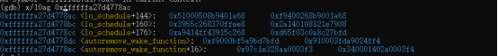
2、查看代码行号
A)查看函数
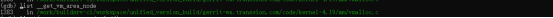
B) 通过Call trace的堆栈查看卡死在哪一行
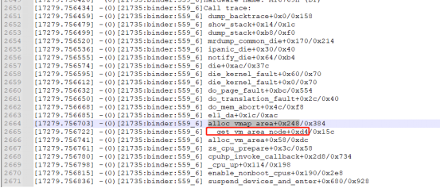
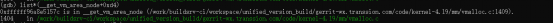
3、查看堆栈
a)查看所有栈帧
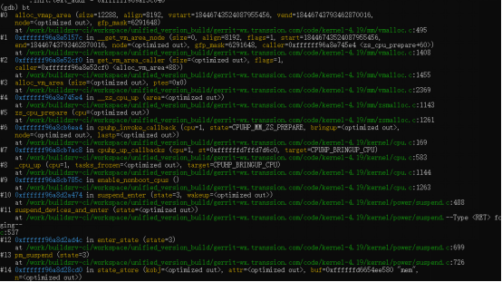
Bt 或backtrace
b)查看栈帧信息
1、选择特定栈帧，如栈帧1
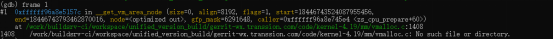
2、栈帧详细信息
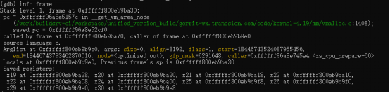
3、查看函数参数值
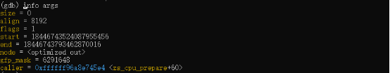
4、查看变量值
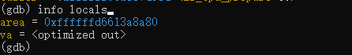
或者
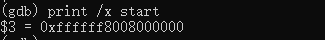
5、查变量类型
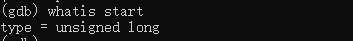
显示的更详细
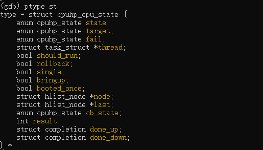
6、查寄存器
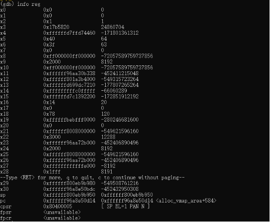
