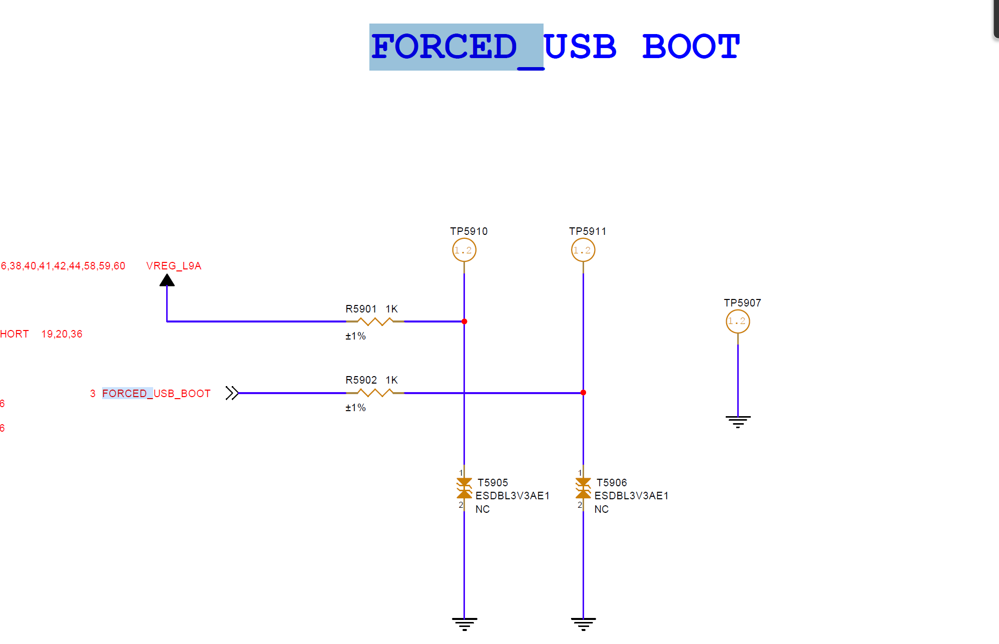
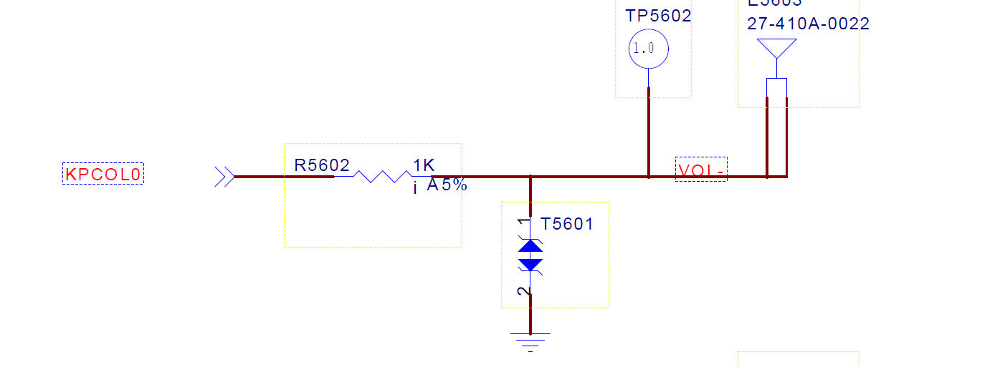

# 手机平台强制下载

## qcom

* 当机器有刷软件（xbl） 时，同时按住音量+-进入9008下载口。
* 高通强制下载引脚为FORCED_USB_BOOT，需要接 1.8V供电进入9008下载口。

## mtk

* 当有刷preloader，直接插USB会进入preloader下载口
* 按住power + 音量- 再接入USB线，会进入BROM下载口
* 强制下载点(KPCOL0 pin)接地，会进入BROM下载口

## 展锐

找原理图 keyin0 对应的 按键 就是进入下载模式的按键

