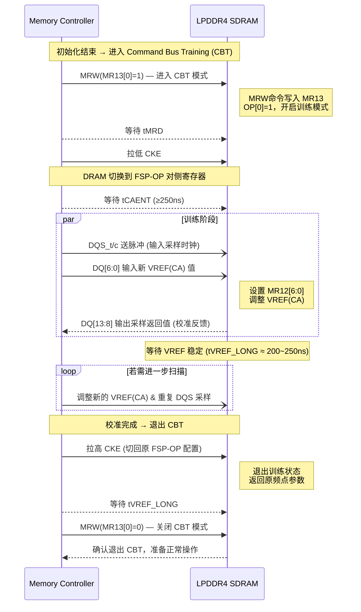

# marmind
当然可以。下面是一个用 **Mermaid** 绘制的 **LPDDR4 Command Bus Training（CBT） 时序图** 示例，
它反映 JESD209‑4 第 4.21 节描述的信号关系及关键时序点（如 *tCAENT*、*tVREF_LONG* 等）。

---

---

### ✅ 图示说明
- **CTRL**：主机内存控制器。
- **DRAM**：被校准的 LPDDR4 存储体。
- **MRW(MR13[0]=1)**：写入 MR13 使能 CBT 模式。
- **CKE 下降**：DRAM 切换至另一频率集 (FSP-OP[y])。
- **tCAENT**：CKE 下降后到可接受 CA/VREF 输入的最短时间。
- **tVREF_LONG**：设置新的 VREF 后需要等待的稳定时间 (~250ns)。
- **DQS/DQ 交互**：控制器发送训练数据脉冲、DRAM 输出校准反馈。
- **CKE 上升 + MR13[0]=0**：退出 Command Bus Training，恢复正常工作。

---

如果你在 Markdown 编辑器中启用了 Mermaid（例如 VSCode、Typora 或 GitHub 支持渲染的环境），复制以上内容就能直接生成一个结构清晰的 **CBT 时序图**。

在 LPDDR4 中，凡是会随高、低工作频率变化而不同的运行参数，通常都配备**两个物理寄存器副本**。
这两个副本共用相同的模式寄存器地址，但要访问哪一个副本，则由以下两个位控制：

* **FSP‑WR（Frequency Set‑Point Write/Read）** — 决定当前读写的是哪一个物理寄存器副本；
* **FSP‑OP（Frequency Set‑Point Operation）** — 决定 DRAM 此刻实际使用的参数组。

通常具备两个物理寄存器副本、由 FSP 机制控制的参数，是那些会因频率、电压摆幅或端接设置而变化的模式寄存器参数。根据 JEDEC JESD209‑4 (LPDDR4) 规范，例如包括：

| 模式寄存器 | 含义 / 受 FSP 控制的双寄存器参数 |
|-------------|------------------------------------|
| **MR1** | 驱动强度、RTT（DQ 端接）、输出转换速率 |
| **MR2** | 均衡控制、写入定时/门控训练启用位 |
| **MR3** | 输出驱动配置、命令/地址端接 RTT 设置 |
| **MR11** | 与频率相关的定时或功能启用位 |
| **MR12** | VREF(CA) 范围和值 |
| **MR14** | VREF(DQ) 范围和值 |
| **MR22** | 与训练相关的控制，如读/写延迟调整 |

这些被复制的寄存器构成了**两个频率设定点寄存器组**（FSP‑OP\[0] 和 FSP‑OP\[1]）。
当需要将 DRAM 调整到另一工作频率时，先通过 **FSP‑WR** 选择备用寄存器组，对其写入新的参数值，然后切换 **FSP‑OP** 使该组立即生效。

|                                  功能名称                                   | 相关寄存器及位段 | 数据（Data）取值 |             对寄存器的影响（操作）              |               备注说明                |
| -------------------------------------------------------------------------- | --------------- | --------------- | -------------------------------------------- | ------------------------------------ |
| **FSP‑WR** （频率设定点写入控制，*Frequency Set Point Write/Read Enable*） | MR13 OP\[6]     | 0 （默认）       | 通过 MRW 命令对 **FSP‑OP\[0]** 寄存器组写入数据 | 表示正在配置 FSP‑0，对应低频或初始设置点 |
|                                                                            |                 | 1               | 通过 MRW 命令对 **FSP‑OP\[1]** 寄存器组写入数据 | 表示正在配置 FSP‑1，对应高频或备用设置点 |
| **FSP‑OP** （频率设定点工作控制，*Frequency Set Point Operating Point*）   | MR13 OP\[7]     | 0 （默认）       | DRAM 按照 **FSP‑OP\[0]** 寄存器组的参数运行     | DRAM 当前采用 FSP‑0 运行参数           |
|                                                                            |                 | 1               | DRAM 按照 **FSP‑OP\[1]** 寄存器组的参数运行     | DRAM 当前采用 FSP‑1 运行参数           |