<a id="html-eaa94f9a661dc36355d6"></a>
# **Bitmap泄漏问题总结**

http://jira-ex.transsion.com:6001/browse/X6526V6AEE-107

最近我司项目(`MTK`平台)跑`monkey`过程中出现`system_server JE` 导致上层重启
 `system_server`发生 `JE`的原因是: `system_server`进程 `OutOfMemoryError`


```txt
E AndroidRuntime: *** FATAL EXCEPTION IN SYSTEM PROCESS: binder:1375_1A
E AndroidRuntime: java.lang.OutOfMemoryError: pthread_create (1040KB stack) failed: Try again
E AndroidRuntime: 	at java.lang.Thread.nativeCreate(Native Method)
E AndroidRuntime: 	at java.lang.Thread.start(Thread.java:976)
E AndroidRuntime: 	at com.android.server.pm.AbstractStatsBase.maybeWriteAsync(AbstractStatsBase.java:85)
E AndroidRuntime: 	at com.android.server.pm.dex.PackageDynamicCodeLoading.maybeWriteAsync(PackageDynamicCodeLoading.java:244)
E AndroidRuntime: 	at com.android.server.pm.dex.DynamicCodeLogger.recordDex(DynamicCodeLogger.java:227)
E AndroidRuntime: 	at com.android.server.pm.dex.DexManager.notifyDexLoadInternal(DexManager.java:269)
E AndroidRuntime: 	at com.android.server.pm.dex.DexManager.notifyDexLoad(DexManager.java:198)
E AndroidRuntime: 	at com.android.server.pm.PackageManagerService$IPackageManagerImpl.notifyDexLoad(PackageManagerService.java:5519)
E AndroidRuntime: 	at android.content.pm.IPackageManager$Stub.onTransact(IPackageManager.java:3301)
E AndroidRuntime: 	at com.android.server.pm.PackageManagerService$IPackageManagerImpl.onTransact(PackageManagerService.java:6231)
E AndroidRuntime: 	at android.os.Binder.execTransactInternal(Binder.java:1286)
E AndroidRuntime: 	at android.os.Binder.execTransact(Binder.java:1245)
E AndroidRuntime: OutOfMemoryError IN SYSTEM PROCESS: Already dump hprof!
E AndroidRuntime: java.lang.OutOfMemoryError: pthread_create (1040KB stack) failed: Try again
E AndroidRuntime: 	at java.lang.Thread.nativeCreate(Native Method)
E AndroidRuntime: 	at java.lang.Thread.start(Thread.java:976)
E AndroidRuntime: 	at com.android.server.pm.AbstractStatsBase.maybeWriteAsync(AbstractStatsBase.java:85)
E AndroidRuntime: 	at com.android.server.pm.dex.PackageDynamicCodeLoading.maybeWriteAsync(PackageDynamicCodeLoading.java:244)
E AndroidRuntime: 	at com.android.server.pm.dex.DynamicCodeLogger.recordDex(DynamicCodeLogger.java:227)
E AndroidRuntime: 	at com.android.server.pm.dex.DexManager.notifyDexLoadInternal(DexManager.java:269)
E AndroidRuntime: 	at com.android.server.pm.dex.DexManager.notifyDexLoad(DexManager.java:198)
E AndroidRuntime: 	at com.android.server.pm.PackageManagerService$IPackageManagerImpl.notifyDexLoad(PackageManagerService.java:5519)
E AndroidRuntime: 	at android.content.pm.IPackageManager$Stub.onTransact(IPackageManager.java:3301)
E AndroidRuntime: 	at com.android.server.pm.PackageManagerService$IPackageManagerImpl.onTransact(PackageManagerService.java:6231)
E AndroidRuntime: 	at android.os.Binder.execTransactInternal(Binder.java:1286)
E AndroidRuntime: 	at android.os.Binder.execTransact(Binder.java:1245)
```

(出现这类调用栈,貌似只能表明该进程内存溢出了,调用栈只表明此时申请内存时,已经申请不到了,并不能说明是此处导致内存溢出)

<a id="html-aba1f2d54e572325048d"></a>
## **1.排查异常log**

尽可能通过现有log,排查可能的异常点,联系异常log对应模块同事尽可能获取更多信息

由于我司`Monkey`是使用自己的自动化测试平台进行测试,log只有`mtk d`b文件以及`main log`.无hprof文件.较难排查.
 好在从有限的`log`中能排查到异常点,通过`log`,尝试手动复现找到问题的必现路径.

通过`log`排查,我们可以看到`system_server`发生`OOM`之前有异常`log`:

- `system_server`进程不能申请到bitmap内存数据
- `bitmap`打印`out of memory`警告`Bitmap : mmap failed, error 12 (Out of memory)`

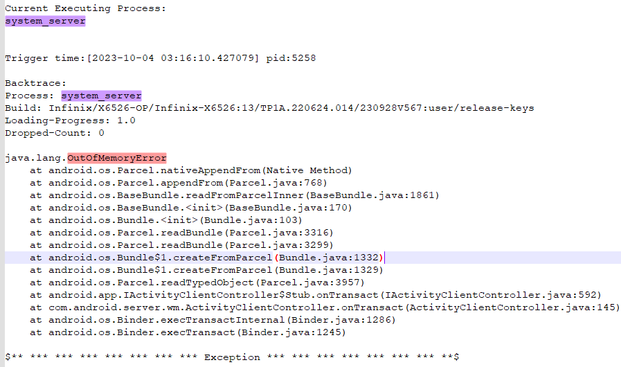

如下能看到频繁的log:

- 客户定制`appwidget`相关的`log` 频繁打印,经咨询客户对应工程师表明.
- 该`log`是打印出`appwidget`行为以及`type` 是此时`appwidge`t的行为

1. WIDGET\_TYPE\_ADD = 0
2. WIDGET\_TYPE\_UPDATE = 1
3. WIDGET\_TYPE\_REMOVE = 2

可见此时这么多的`appwidget`正在更新
 小部件: 录音机:`com.transsion.soundrecorder`


根据以上`log`,我们不难想到可能是`Monkey`场景下频繁添加录音机小部件导致的.

<a id="html-e23697169efc0ca37659"></a>
## **2.找到问题复现路径**

尝试缩小问题复现场景,通过`log`尝试手动复现问题,(找必现路径过程中,实时观察是否有先前怀疑的异常`log`打出)

<a id="html-8459f4bad3462584e594"></a>
### **2.1复现路径**

本来我打算让测试同事在`Launcher`+`录音机` 这个场景下使用`userdebug`版本去压测复现.后来自己尝试添加完100个录音机小部件后,左右滑动,手机没有问题(动态输出log中没有看到上述异常log).
 当我尝试打开录音小部件按钮开始录音,异常log开始打印.桌面滑动也变得顿卡.100个小部件同时更新UI(计时变化),小部件UI也顿卡,正常小部件UI时间显示是1s一次,顿卡时3/4s更新一次尝试两三次亮灭屏手机卡死.稍后system\_server OOM 导致重启.复现到此问题(可查看附件录屏:`Bitmap泄漏system_server重启_resource\1_问题log复现路径录屏.mp4`)

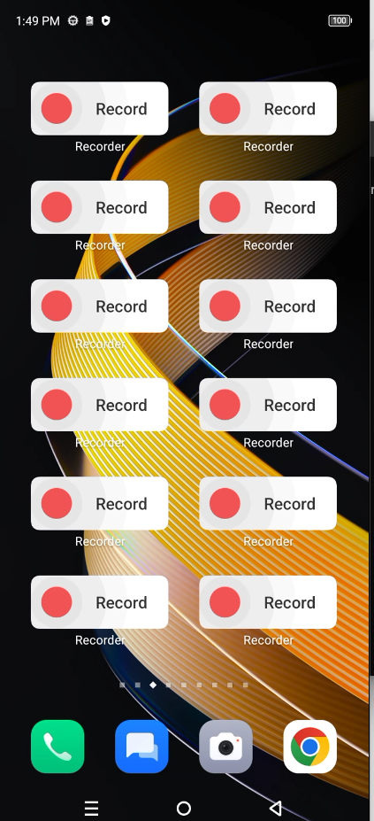

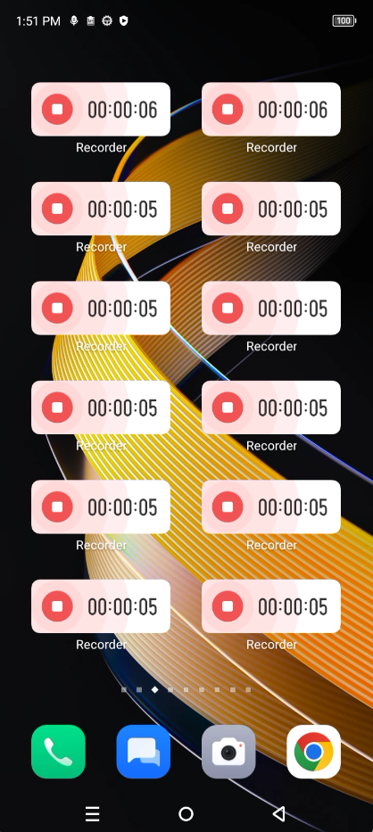

<a id="html-982d4ed0b45f0a2058f2"></a>
### **2.1抓取完整log**

抓取`log`(hprof,mobile\_log,db等),以及录屏
 如附件: Bitmap泄漏system\_server重启\_resource\1\_问题log

Userdebug版本问题复现后,

- 将`data/hprof`下的文件导出来(`Bitmap泄漏system_server重启_resource\1_问题log\3_data_hprof\system_server_OOM_1375_2023-10-09-10-32-43.hprof`)
- 使用`hprof-conv.exe`(from:`AppData\Local\Android\Sdk\tools`) 工具转换.(可在附件:`Bitmap泄漏system_server重启_resource\2_分析工具\hprof-conv.exe`)

hprof-conv system\_server\_OOM\_1375\_2023-10-09-10-32-43.hprof hsy.hprof

<a id="html-e10ce90f6a2463ebdd5a"></a>
## **3.问题排查**

<a id="html-0d5390a8c64875d50f34"></a>
### **3.1 Mat(Memory Analyzer)分析**

- 再使用`mat(Memory Analyzer)`工具解析查看释放存在泄漏以及哪些类内存占用过高.(工具:`Bitmap泄漏system_server重启_resource\2_分析工具\MemoryAnalyzer-1.14.0.20230315-win32.win32.x86_64 (2).zip`)

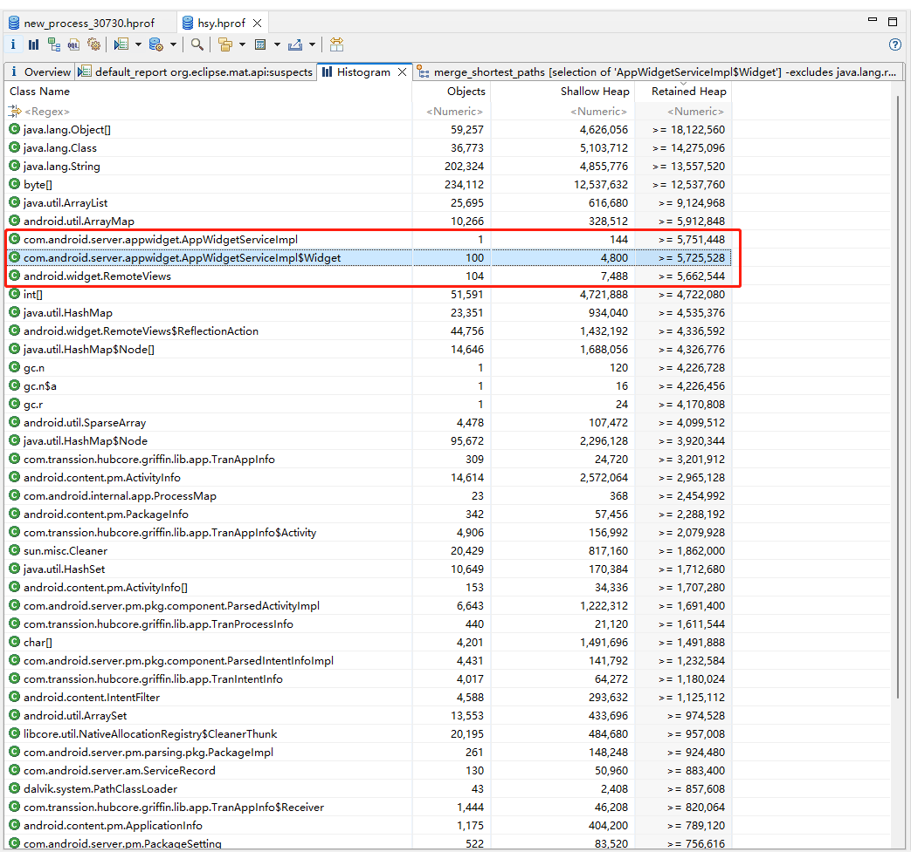

从图标来看,三个实例的内存占用应该是正常的,因为我们的场景如此.添加了100个小部件情况下.

- `com.android.server.appwidget.AppWidgetServiceImpl$Widget`--100
- `android.widget.RemoteViews`--104

所以只能知道此场景下这两个实例占用内存会较多.

<a id="html-c26548eb9b125e0a7bb9"></a>
### **3.2 AS.profiler排查**

由于场景必现,可以使用`AndroidStudio.profiler`工具实时排查

使用`Memory Analyzer`工具有个局限性,就是只能看到`Java`相关内存信息.
 并且由于问题复现场景已经确定,我们可以使用`Android studio`中的`Profiler`工具实时查看场景运行过程中`system_server`的内存信息,这里的内存信息就较多,`JAVA`和`Native`的都能看得到.
 关于这几项信息解释(看文末 `### 4.1 hprof的几个内存关键参数解释`)

- **Native Size**
- **Shallow Size**
- **Retained Size**

我们使用`Retained Size`项来进行排序.

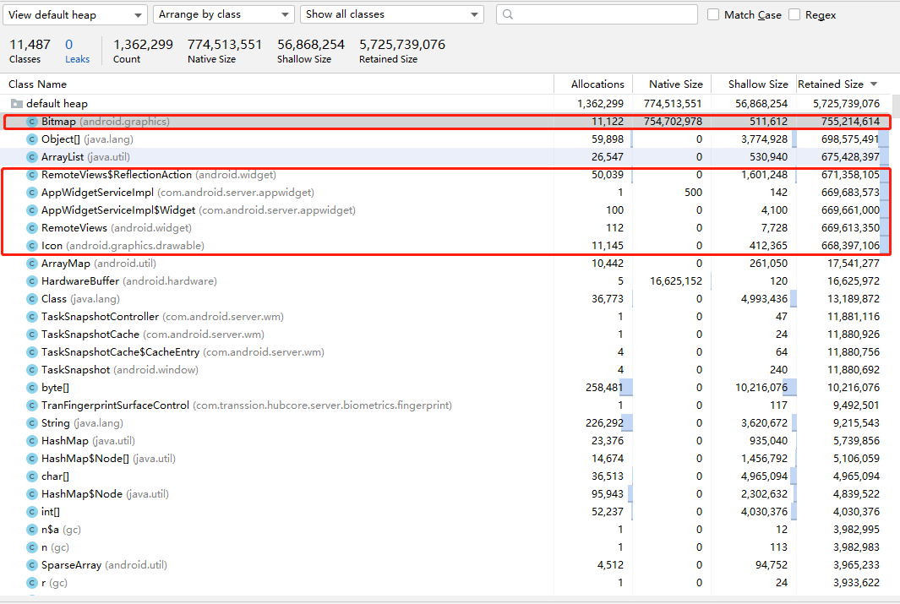

我们能看到占比较高的是:

- `Bitmap` 的`Retained size`较高,内存主要是来自`Native` 的占用较高,其次就是基础数据类型:`ArrayList`和`Object`
- 其次就是刚刚
    - `RemoteView$ReflectionAction`
    - `AppWidgetServiceImpl`
    - `AppWidgetServiceImpl$Widget`
    - `RemoteViews`
    - `Icon`

我们可以点击上面各个实例查看让他们的`GC root`

- `AppWidgetServiceImpl`

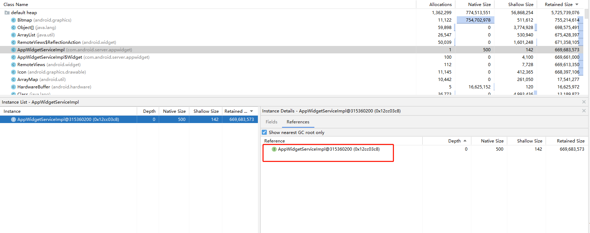

- `AppWidgetServiceImpl$Widget`

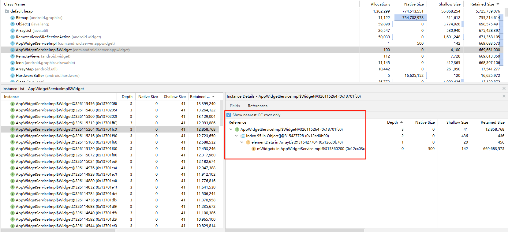

- `RemoteViews`

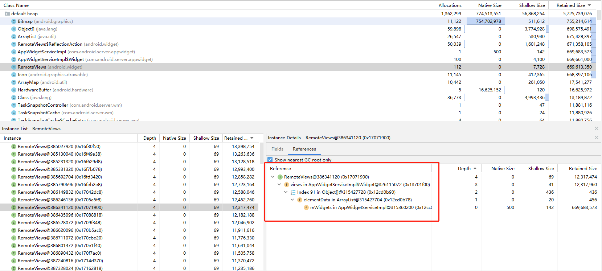

- `ArrayList`

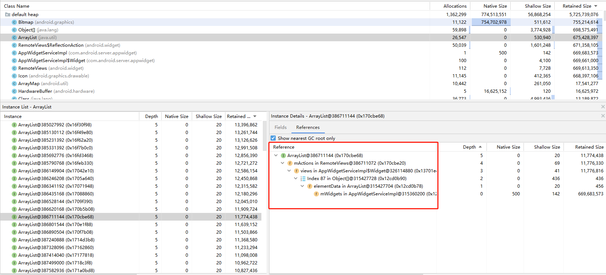

- `RemoteView$ReflectionAction`

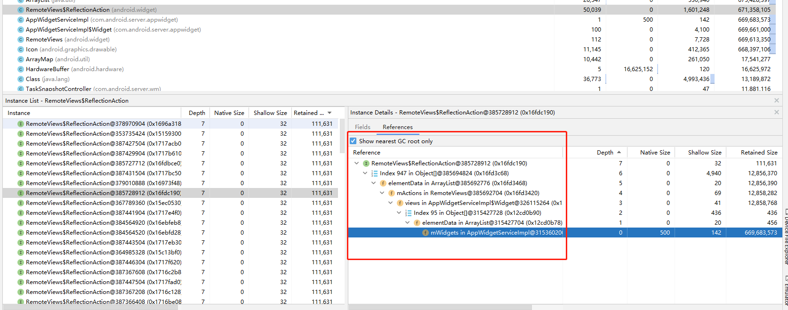

- `Icon`

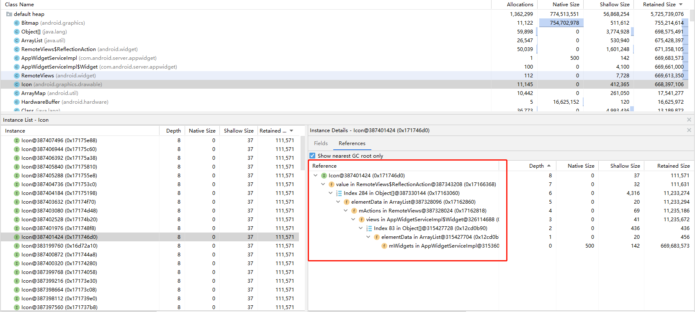

- `Bitmap`

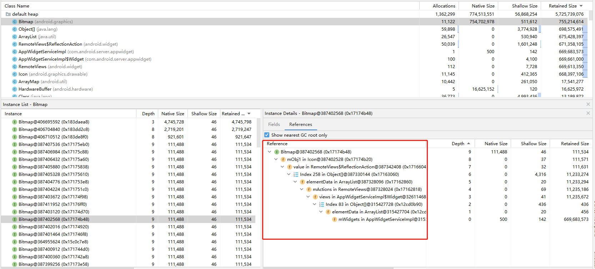

从上面的`GC root`路径,大家应该能看出来.占用最高这几个实例都是相互关联的(同时可以留意红框右边的`Depth`栏,`GCroot`的`Depth`值最小)
 从根到各个对象顺序如下
 `AppWidgetServiceImpl`-->`AppWidgetServiceImpl$Widget`-->`RemoteViews`-->`ArrayList`
 -->`RemoteView$ReflectionAction`-->`Icon`-->`Bitmap`

我们可以在`AppWidgetServiceImpl`的`Fields`项 查看这个路径(虽然不太直观,但是能看到各个成员的关系)

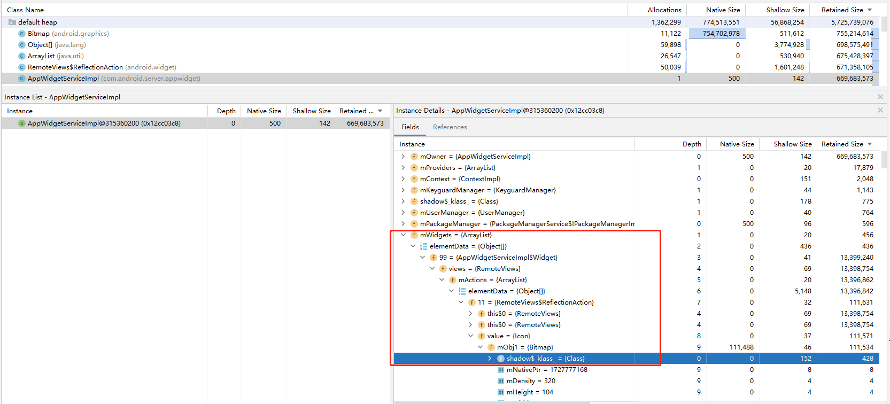

为了直观我将数量也统计上去

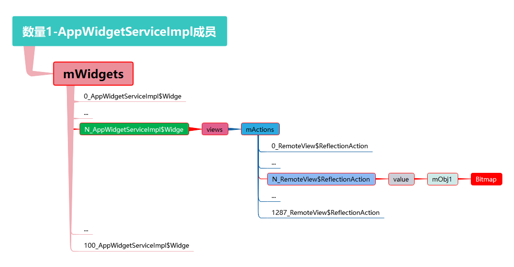

描述

- `AppWidgetServiceImpl`中的成员`mWidget`是一个`ArrayList`
- `mWidget`中每一项存放这个多个`AppWidgetServiceImpl$Widget` 实例
- `AppWidgetServiceImpl$Widget`中的 `views`成员存放着一个`ArrayList:mActions`
- `mActions`中每一项都存放着`RemoteView$ReflectionAction`实例
- `RemoteView$ReflectionAction`中的包含成员`value`
- `value`中存放成员`mObj1`,这个`mObj1`存放着`Bitmap`

此时我们已经能看到问题的根本原因:在于大量的`Bitmap`未能被释放.
 由于大量Bitmap占用内存较多,所以我这边咨询了一下录音机同事是如何更新小部件UI的,以及RemoteViews /BitmapReflectionAction是如何使用的?

```txt
//相关同事给的答复
widgetView.setImageViewIcon(R.id.bg_view, getBgBitmap(widgetInfo, op(widgetInfo.isLargeScreen(), startBgArray[theme], normalBg), theme).toIcon())
widgetView.setImageViewResource(R.id.icon, op(widgetInfo.isWidthCell5, startSmallIconArray[theme], startIconArray[theme]))

setImageViewIcon    //是更新背景

setImageViewResource//是更新小部件左边的按钮
```

<a id="html-faeb5ee7f641aef98ccf"></a>
### **3.3 找到泄漏怀疑点**

从上可以看到确实有在使用`Bitmap`添加到`widgetView`中
 我们需要查找Bitmap未能释放的原因,我们可以开始从`Bitmap`到`GCroot`回溯哪里存在异常.或者从`GCroot`开始往下查找.
 1.从`Bitmap`开始回溯.选中一个`Bitmap` 实例`Instance`(选择同类型出现最多的其中一个即可) 查看`References`项选中 `Show nearest GCroot`

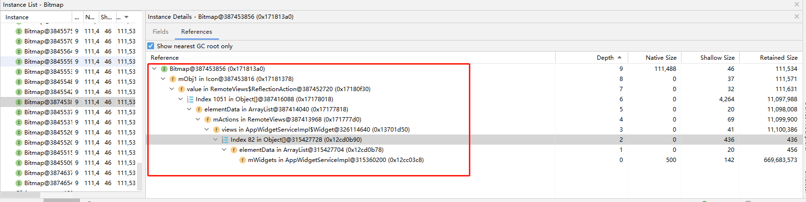

查看红框中这些成员哪些数量多,哪些可以释放但是迟迟未被释放.需要查看代码逻辑.
 结合我统计的那个图可以知道,以下两个成员是较多的

- `mWidgets` **100**个实例`Widget`
- `mActions` **1287**个实例`Action`

由于我添加了100个录音小部件所以对应会生成着 100个`mWidget`的列表实例`Widget`,这里显然释放不了,除非我将小部件一个个移除掉
 那么`mActions`呢?
 每一个`Widget`间接存放着1000多个`mActions`的列表成员`Action`.这里显然太多了.这里将是一个怀疑点

<a id="html-22dd3c8ea3a34f8e2bb0"></a>
### **3.4 查看怀疑点相关代码**

通过查阅代码发现.录音机更新小部件`UI`是通过`setImageViewIcon(,)`接口,接口中将`Bitmap` 封装为`ReflectionAction`存在`mActions` 中.通过查看`mActions`发现,包含的`Action`只会不断增加.移除`mActions`列表中各个`action`的唯一方法为 `partiallyUpdateAppWidget`.
 通过查阅发现这个方法基本上很少有`apk`使用.经常使用的接口为`appWidgetManager.updateAppWidget`,此次录音机应用也是调用的`updateAppWidget`接口进行更新`UI`.
 查看`RemoteViews.java`代码发现`RemoteView`中的`set开头`的方法均会new一个新的`XXXaction`添加`mActions`中

```java
frameworks/base/core/java/android/widget/RemoteViews.java
    public void setImageViewIcon(@IdRes int viewId, Icon icon) {
        setIcon(viewId, "setImageIcon", icon);
    }
    public void setIcon(@IdRes int viewId, String methodName, Icon value) {
        addAction(new ReflectionAction(viewId, methodName, BaseReflectionAction.ICON, value));
    }
    public void setImageViewResource(@IdRes int viewId, @DrawableRes int srcId) {
        setInt(viewId, "setImageResource", srcId);
    }
    public void setInt(@IdRes int viewId, String methodName, int value) {
        addAction(new ReflectionAction(viewId, methodName, BaseReflectionAction.INT, value));
    }
	//...等等方法均会new一个Action添加到mAction成员中
```

排查`appWidgetManager.updateAppWidget` 代码流程:
 代理端的接口最终会调用导服务端的`updateAppWidgetIds(,)`接口

```java
//frameworks/base/services/appwidget/java/com/android/server/appwidget/AppWidgetServiceImpl.java
//调用的方法为updateAppWidgetIds
    @Override
    public void updateAppWidgetIds(String callingPackage, int[] appWidgetIds,
            RemoteViews views) {
        if (DEBUG) {//因为有必现路径,我将还将此DEBUG这个开关打开了,为了能发现更多信息
            Slog.i(TAG, "updateAppWidgetIds() " + UserHandle.getCallingUserId());
        }

        updateAppWidgetIds(callingPackage, appWidgetIds, views, false);//详见: updateAppWidgetIds
    }
//这个是刚刚提到的 partiallyUpdateAppWidget调用到的接口
    @Override
    public void partiallyUpdateAppWidgetIds(String callingPackage, int[] appWidgetIds,
            RemoteViews views) {
        if (DEBUG) {
            Slog.i(TAG, "partiallyUpdateAppWidgetIds() " + UserHandle.getCallingUserId());
        }
        //参数最后一个为true,最终会将新旧两个action合并,即移除mActions的唯一地方
        updateAppWidgetIds(callingPackage, appWidgetIds, views, true);
    }
```

**updateAppWidgetIds(,)**
 通过appWidgetId 找到对应的小部件进行跟新

```java
private void updateAppWidgetIds(String callingPackage, int[] appWidgetIds,
            RemoteViews views, boolean partially) {
        //部分省略
        synchronized (mLock) {
            final int N = appWidgetIds.length;
            for (int i = 0; i < N; i++) {
                final int appWidgetId = appWidgetIds[i];
                //....
                Widget widget = lookupWidgetLocked(appWidgetId,
                        Binder.getCallingUid(), callingPackage);

                if (widget != null) {
                    updateAppWidgetInstanceLocked(widget, views, partially);//详见updateAppWidgetInstanceLocked(widget, views, partially)
                }
            }
        }
    }
```

**updateAppWidgetInstanceLocked(,,)**
 分析如下

```java
private void updateAppWidgetInstanceLocked(Widget widget, RemoteViews views,
            boolean isPartialUpdate) {
            //...
            if (isPartialUpdate && widget.views != null) {
                // For a partial update, we merge the new RemoteViews with the old.
                widget.views.mergeRemoteViews(views);
            } else {
                // For a full update we replace the RemoteViews completely.
                widget.views = views;
            }
            //这里将会统计小部件中使用BitMap内存,如果超过屏幕宽×高×1.5×4大小将会抛出异常造成应用异常退出,
            //***我们这个问题system_server重启前出现了录音机由于这个原因闪退可查看crashlog中信息,能看到
            int memoryUsage;
            if ((UserHandle.getAppId(Binder.getCallingUid()) != Process.SYSTEM_UID) &&
                    (widget.views != null) &&
                    ((memoryUsage = widget.views.estimateMemoryUsage()) > mMaxWidgetBitmapMemory)) {
                widget.views = null;
                throw new IllegalArgumentException("RemoteViews for widget update exceeds"
                        + " maximum bitmap memory usage (used: " + memoryUsage
                        + ", max: " + mMaxWidgetBitmapMemory + ")");
            }
            scheduleNotifyUpdateAppWidgetLocked(widget, widget.getEffectiveViewsLocked());
        }
    }
```

- 如果是部分跟新(`partiallyUpdateAppWidget`),将会将`RemoteView`中的`mAction`进行新老`action`合并,如果已经存在的`action` 那么新的`action`将会丢掉(其实看到这里我有想让录音同事使用`partiallyUpdateAppWidget`代替使用`UpdateAppWidget`,但是查阅api资料后,发现两者并不是提代的关系,使用`partiallyUpdateAppWidget`场景并不是在添加action之后,所以没有让其修改)
- 如果是`UpdateAppWidget`则将新的`RemoteView`替换老的`RemoteView`,间接说明`mAction`也会跟着变化(老RemoteView将会被回收,那么Action也将会被回收,bitmap也将被回收).
 从这里来看,正常来说一RemoteView不应该像hprof中那样有1000多个action的.而且action大多都是包含Bitmap.看到这里我怀疑难道录音机应用的代码中将RemoteView保存着,重复使用吗?

所以咨询了一下录音机的开发是否在代码中将RemoteView保存着,重复使用

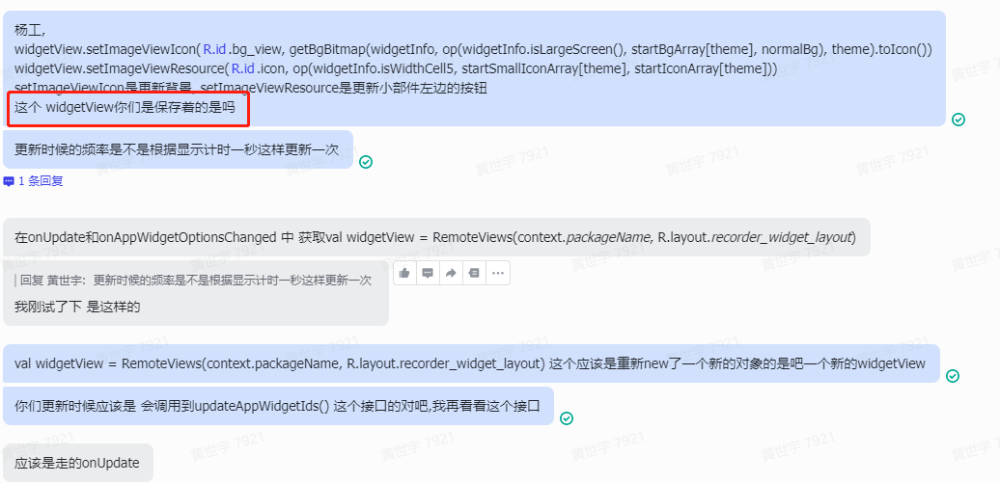

后面我要了一份关于 录音机小部件实现的代码 即AppWidgetProvider类的实现地方(附件: `Bitmap泄漏system_server重启_resource\AppWidgetProvider.txt`)

我们主要关注:
 1.remote是否被复用
 2.以及UpdateAppWidget的调用时机

```kotlin
class RecorderWidgetProvider: AppWidgetProvider() {
    //无关代码我进行省略
    override fun onUpdate(context: Context, appWidgetManager: AppWidgetManager, appWidgetIds: IntArray) {
        super.onUpdate(context, appWidgetManager, appWidgetIds)
        val widgetView = RemoteViews(context.packageName, R.layout.recorder_widget_layout)//<---------异常点RemoteViews存在复用,100个小部件场景,100个小部件共用一个RemoteView
        for (widgetId in appWidgetIds) {
            updateWidgetView(context.applicationContext, widgetView, appWidgetManager, widgetId)
        }
    }
    private fun updateWidgetView(context: Context, widgetView: RemoteViews, manager: AppWidgetManager, appWidgetId: Int) {
        //....省略
        widgetView.setImageViewIcon(R.id.bg_view, getBgBitmap(XXX).toIcon())
        widgetView.setImageViewResource(R.id.icon, op(XXX))
        manager.updateAppWidget(appWidgetId, widgetView)//<----------------调用updateAppWidget进行更新
    }
    override fun onEnabled(context: Context?) {
        //...
    }
    override fun onDisabled(context: Context?) {
         //...
    }
    override fun onReceive(context: Context, intent: Intent) {
         //...
    }
    override fun onAppWidgetOptionsChanged(context: Context, appWidgetManager: AppWidgetManager, appWidgetId: Int, newOptions: Bundle) {
        //...
    }
}
```

从上面的代码我们确实能发现存在`RemoteView`复用的情况:
 即一个`RemoteView`调用`setImageViewIcon`,所有其他小部件被引用的`RemoteView`中的`mActions`列表都会增加

<a id="html-081ef13fc7e615de59a8"></a>
### **3.5修改建议**

我给录音机开发同事提建议将`RemoteView` 放到`for循环`中,这样一个小部件就只使用自己的一个`RemoteView`.

```kotlin
class RecorderWidgetProvider: AppWidgetProvider() {
    override fun onUpdate(context: Context, appWidgetManager: AppWidgetManager, appWidgetIds: IntArray) {
        super.onUpdate(context, appWidgetManager, appWidgetIds)
        for (widgetId in appWidgetIds) {
            \\appWidget对应一个新RemoteView
            val widgetView = RemoteViews(context.packageName, R.layout.recorder_widget_layout)\\appWidget对应一个新RemoteView
            updateWidgetView(context.applicationContext, widgetView, appWidgetManager, widgetId)
        }
    }
}
```

使用修改后的录音机进行在相同手机系统版本测试,手机使用流畅,小部件UI流畅,亮灭屏10多次,未见重启,也未见打印bitmap异常log(可看附件中修改的录屏)
 抓了一份录音6小时后`hprof`(`Bitmap泄漏system_server重启_resource\1_问题log\After_Modified_Catch_memory-20231012T210526.hprof`),
 看一下是不是bitMap的分配个数和内存的大小是不是小很多比起之前

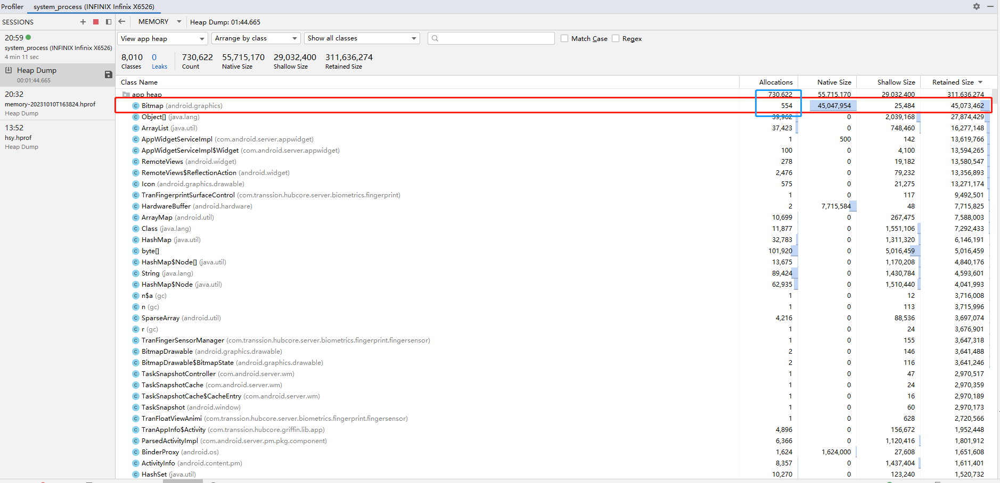

| 时间 | 异常时Allocations | Native Size |
| --- | --- | --- |
| 异常时 | 11122 | 754702978 |
| 修改后 | 554 | 45047954 |

<a id="html-917d5ac728188ce0d9c3"></a>
## **4.参考**

<a id="html-053a64dc0ea665561dc4"></a>
### **4.1 hprof的几个内存关键参数解释**

关于这几项的信息如下

**Allocations**：堆中的分配数。
 **Native Size**：此对象类型使用的原生内存总量（以字节为单位）。只有在使用 Android 7.0 及更高版本时，才会看到此列。您会在此处看到采用 Java 分配的某些对象的内存，因为 `Android`对某些框架类（如 `Bitmap`）使用原生内存。
 **Shallow Size**：此对象类型使用的 Java 内存总量（以字节为单位）。
 **Retained Size**：为此类的所有实例而保留的内存总大小（以字节为单位）。

from:https://developer.android.google.cn/studio/profile/memory-profiler?hl=zh-cn

上面几个概念来源官网比较生硬,较容易理解的如下:

- **Native Size**
- **Shallow Size**
- **Retained Size**

我们用下图来表示某段 `Heap Dump` 记录的应用内存状态。注意红色的节点，在这个示例中，这个节点所代表的对象从我们的工程中引用了 Native 对象:


这种情况不太常见，但在 Android 8.0 之后，使用 `Bitmap` 便可能产生此类情景，因为 `Bitmap` 会把像素信息存储在原生内存中来减少 `JVM` 的内存压力。(我们的这个问题就是这样)

先从 `Shallow Size` 讲起，这列数据其实非常简单，就是对象本身消耗的内存大小，在上图中，即为**红色节点**自身所占内存。而 `Native Size` 同样也很简单，它是类对象所引用的 `Native` 对象 (**蓝色节点**) 所消耗的内存大小:

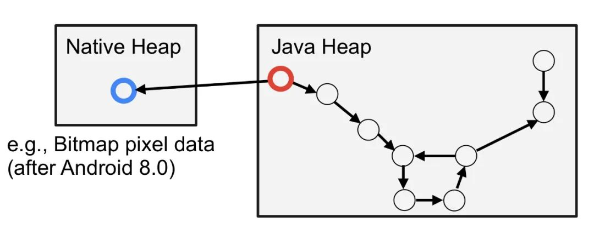

`Retained Size` 稍复杂些，它是下图中所有橙色节点的大小:

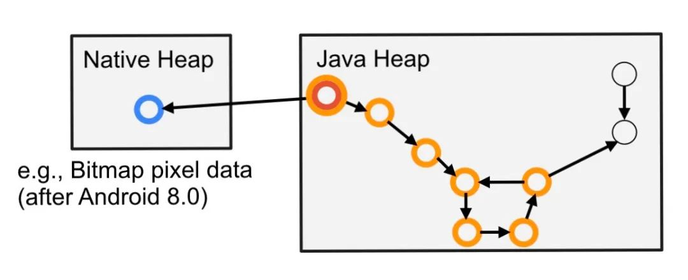

由于一旦删除红色节点，其余的橙色节点都将无法被访问，这时候它们就会被 GC 回收掉。从这个角度上讲，它们是被红色节点所持有的，因此被命名为 `Retained Size`。
 参考

使用 Android Studio Profiler 工具解析应用的内存和 CPU 使用数据
 https://mp.weixin.qq.com/s/MIuSi85lnrETqq3rl0Hc6A
 RemoteViews 中暗藏的坑
 https://blog.csdn.net/u013989732/article/details/78501462